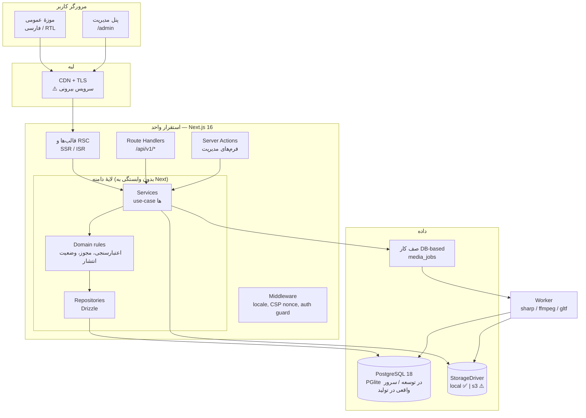
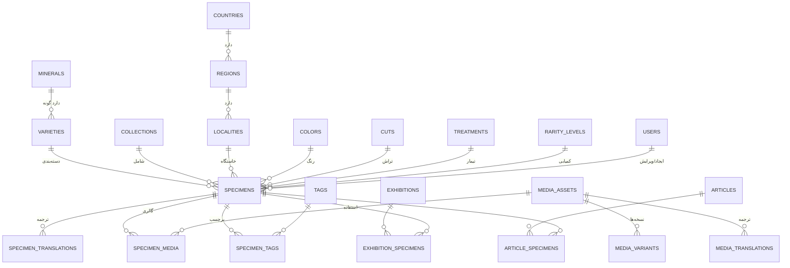

# گموریا — موزهٔ دیجیتال سنگ‌های قیمتی
## سند برنامهٔ فنی و معماری (نسخهٔ ۱٫۰)

| مورد | مقدار |
|---|---|
| **پروژه** | GEMORIA — Digital Gemstone Museum |
| **مخزن کد** | `milanorezaee2/zibanit` (شاخهٔ کاری: `arena/a46cab47-zibanit`) |
| **وضعیت سند** | پیش‌نویس جهت تأیید — **هیچ کدی از برنامهٔ اصلی هنوز نوشته نشده است** |
| **تاریخ** | ۱۴۰۴/۰۸/۲۶ |
| **دامنهٔ فاز اول** | فارسی کامل، RTL کامل، بدون قابلیت خرید |

> **این سند چه چیزی نیست:** سند بازاریابی، ماکاپ یا فهرست آرزوها نیست. هر قابلیت در یکی از سه دستهٔ زیر قرار گرفته و برچسب خورده است:
> **✅ تأییدشده** = در همین محیط اجرا و آزمایش شد و خروجی گرفتم. **⚠️ نیازمند سرویس بیرونی** = کد قابل نوشتن است ولی برای کارکرد واقعی به حساب/سرویس/اعتبارنامهٔ شما نیاز دارد. **❌ در این محیط ممکن نیست** = راه‌حل جایگزین پیشنهاد شده است.

---

## ۰. خلاصهٔ مدیریتی (برای تصمیم‌گیری سریع)

۱. **معماری پیشنهادی:** یک اپلیکیشن **Next.js 16 (App Router) + React 19 + TypeScript** که هم فرانت‌اند موزه و هم پنل مدیریت و هم API را در یک استقرار واحد ارائه می‌دهد؛ با لایه‌بندی داخلی سخت‌گیرانه (domain / repository / service / http) تا جدایی «موزه» و «مدیریت» در سطح کد و مسیر تضمین شود، نه فقط در سطح ظاهر.

۲. **پایگاه داده:** **PostgreSQL** به‌عنوان موتور واحد در همهٔ مراحل. نکتهٔ کلیدی و تأییدشده: با **PGlite** (PostgreSQL 18.6 کامپایل‌شده به WebAssembly، درون‌فرآیندی) می‌توان همین حالا در این محیط، همان SQL و همان مایگریشن‌های تولید را **بدون Docker** اجرا کرد. یعنی «محیط پیش‌نمایش» و «تولید» یک دیالکت یکسان دارند — ریسک مهاجرت صفر.

۳. **بانک رسانه:** لایهٔ انتزاعی `StorageDriver` با دو پیاده‌سازی: `local` (اکنون، تأییدشده) و `s3` (R2/S3/MinIO، ⚠️ نیازمند اعتبارنامه). پردازش تصویر با **sharp** به‌صورت کامل و آفلاین تأیید شد (AVIF/WebP/JPEG، تغییر اندازه، استخراج متادیتا).

۴. **چندزبانی:** از روز اول با `next-intl` و `localePrefix: 'as-needed'` — فارسی روی ریشهٔ دامنه (`/`)، و انگلیسی/عربی بعداً روی `/en` و `/ar` **بدون هیچ تغییری در URLهای فعلی و بدون بازنویسی**. داده‌های ترجمه در سطح پایگاه داده از ابتدا جدا هستند.

۵. **سه محدودیت واقعی که باید بدانید** (تفصیل در بخش ۱۷): این محیط **میزبان تولید نیست**؛ **ایمیل/پیامک/S3** بدون سرویس بیرونی کار نمی‌کند؛ و **تست E2E مرورگری و باینری‌های GitHub** در این محیط قابل دریافت نیستند.

۶. **نقشهٔ راه:** ۸ فاز با معیار پذیرش قابل‌سنجش (بخش ۱۸). فاز ۰ تا ۱ حدوداً ۲ هفته کار متمرکز؛ کل فاز ۰ تا ۵ حدوداً ۸ تا ۱۰ هفته؛ فاز ۶–۷ (سخت‌سازی و انتشار) تابع تأمین محتوا و میزبانی از طرف شماست.

### ۰٫۱ سجل تصمیم‌های ثبت‌شده (جلسهٔ تأیید)

| کد | تصمیم | وضعیت | اثر بر اجرا |
|---|---|---|---|
| **D-01** | سند فنی **تأیید شد با اصلاحات**؛ اصلاحات در پیام بعدی کارفرما اعمال می‌شود | ✅ ثبت شد | تا دریافت اصلاحات، کد برنامه نوشته نمی‌شود؛ فقط دارایی‌های مستقل از معماری (فونت) پیش می‌رود |
| **D-02** | میزبانی تولید **به فاز ۶ موکول شد** | ✅ ثبت شد | کد از روز اول محیط‌مستقل می‌ماند: هیچ وابستگی به Vercel/Netlify؛ هم `VPS + Docker` و هم `Vercel + Postgres مدیریت‌شده` باید بدون تغییر کد ممکن بمانند (دروازهٔ پذیرش فاز ۶) |
| **D-03** | انتخاب فونت: **مقایسهٔ بصری با پیشنهاد** | ✅ تحویل شد → `docs/type-specimen.html` | توصیه: Amiri (تیتر) + Vazirmatn (متن) + Cormorant Garamond (لاتین)، با Gulzar اختیاری برای نقل‌قول |
| **D-04** | محتوای اولیه: **با نمونهٔ تولیدی شروع شود** | ✅ ثبت شد | ۱۲ تا ۲۰ سنگ نمونه با تصاویر تولیدی، تا موزه در تمام حالات (خالی/پر/فیلتر) واقعی دیده شود؛ بعداً با محتوای نهایی جایگزین می‌شود |
| **D-05** | خوشهٔ PostgreSQL تولید باید **UTF-8** باشد (encoding و ctype) | ✅ ثبت و اعمال شد | `initdb` پیش‌فرض (`SQL_ASCII`/`C`) متن فارسی را در `to_tsvector` بی‌صدا دور می‌ریزد و جست‌وجو را می‌کشد. `src/db/capabilities.ts` این را روی اتصال واقعی می‌سنجد؛ `/api/health` وضعیت `degraded` می‌دهد، `npm run db:doctor` خطا می‌دهد، و هر دو مجموعهٔ آزمون آن را assert می‌کنند. جزئیات: `docs/DATABASE.md` |

> **فاز ۰ تحویل شد.** وضعیت اجرایی، شواهد آزمون و محدودیت‌ها: [`docs/PHASE-0.md`](PHASE-0.md). فاز ۱ آغاز نشده است.

> تصمیم D-04 یک الزام فنی به همراه دارد: نمونه‌ها باید از همان مسیر واقعی (آپلود → پردازش → انتشار) عبور کنند، نه اینکه مستقیم در کد نوشته شوند؛ در غیر این صورت موزه «دمو» می‌شود نه «نرم‌افزار».

---

## ۱. گزارش بازرسی محیط توسعه (شواهد واقعی، نه فرض)

این بخش حاصل اجرای واقعی دستورها در همین سندباکس است. نسخهٔ خام گزارش در `docs/environment-report.md` نگهداری می‌شود.

### ۱٫۱ زیرساخت پایه

| مورد | نتیجه | برچسب |
|---|---|---|
| سیستم‌عامل | Linux، ۲ هستهٔ CPU، ۳٫۹ گیگابایت RAM، ۲۰ گیگابایت فضای آزاد | ✅ |
| Node.js | `v22.22.3` | ✅ |
| npm | `10.9.8` — دسترسی به `registry.npmjs.org` برقرار است (نصب بسته در ۵ تا ۱۲ ثانیه) | ✅ |
| Git / GitHub CLI | `git 2.39.5`، `gh` احراز هویت‌شده به‌عنوان `milanorezaee2` | ✅ |
| Python | `3.11.2` (برای اسکریپت‌های جانبی) | ✅ |
| Docker / Docker Compose | **نصب نیست** | ❌ |
| PostgreSQL / MySQL / Redis به‌صورت سرویس سیستمی | **موجود نیست** | ❌ |
| ffmpeg سیستمی | **موجود نیست** (اما راه‌حل npm در ۱٫۴) | ⚠️ |

### ۱٫۲ آنچه واقعاً ساختیم و اجرا کردیم

| آزمون | روش | نتیجه |
|---|---|---|
| ساخت فرانت‌اند | `next build` روی Next.js **16.4.6** + React **19.3.1** | ✅ موفق، حدود ۲۰ ثانیه، بدون خطا |
| نسخهٔ جایگزین | Next.js **15.5.29** + React 19 | ✅ موفق |
| اجرای خروجی تولید | `output: 'standalone'` روی `0.0.0.0:3111` | ✅ سرور بالا آمد و صفحهٔ فارسی RTL سرو شد |
| سازگاری با پروکسی پیش‌نمایش | درخواست با هدر `Host: <port>-<sandbox>.e2b.app` | ✅ کد ۲۰۰ — برنامه در پیش‌نمایش زنده کار می‌کند |
| **PostgreSQL درون‌فرآیندی** | `@electric-sql/pglite` 0.5.16 → `PostgreSQL 18.6 (wasm32)` | ✅ اجرا، ساخت جدول، درج، کوئری |
| همان، درون Next.js | route handler با PGlite در بیلد standalone | ✅ `{"ok":true,"rows":[...]}` |
| ماندگاری داده | توقف سرور، اجرای مجدد، کوئری | ✅ داده‌ها سالم ماندند (فایل‌محور) |
| ستون تولیدشدهٔ جستجو | `tsvector` با `to_tsvector('simple', …) STORED` | ✅ کار کرد |
| `gen_random_uuid()` | بدون افزونه | ✅ بومی PG18 |
| ORM | `drizzle-orm` 0.45.4 + `drizzle-kit` → تولید مایگریشن SQL | ✅ کاملاً آفلاین |
| SQLite جایگزین | `better-sqlite3` + `node:sqlite` بومی Node | ✅ هر دو کار می‌کنند + FTS5 و توکنایزر trigram |
| ماژول بومی در بیلد Next | `better-sqlite3` با `serverExternalPackages` | ✅ کار کرد (ریسک رایج اینجا منتفی شد) |
| پردازش تصویر | `sharp` 0.35.5 / libvips 8.18.7 | ✅ خروجی AVIF، WebP، JPEG، PNG + متادیتا |
| هش رمز عبور | `@node-rs/argon2` (باینری پیش‌ساخته) | ✅ hash و verify |
| سه‌بعدی | `three` 0.187، `@react-three/fiber` 9.8.2، `@gltf-transform/core` 4.5.1 (خواندن/نوشتن GLB) | ✅ نصب و آزمون GLB |
| ویدیو | ffmpeg استاتیک از بستهٔ npm | ⚠️ کدگذاری H.264 و استخراج poster ✅ / بسته‌بندی HLS ❌ (بیلد ۲۰۱۸) |
| فونت فارسی آفلاین | `@fontsource/vazirmatn` 5.3.0 و چند فونت لاتین | ✅ بدون نیاز به گوگل‌فونت |

### ۱٫۳ آنچه در این محیط بسته است

| مورد | وضعیت | پیامد |
|---|---|---|
| اینترنت عمومی (به‌جز npm / GitHub / PyPI) | ❌ بسته (`example.com`, `images.unsplash.com` → بدون پاسخ) | هیچ CDN تصویر/فونت در زمان ساخت قابل اتکا نیست → **همهٔ رسانه و فونت باید محلی سرو شود** |
| `objects.githubusercontent.com` | ❌ بسته | دانلود باینری از GitHub Releases ممکن نیست (علت شکست `ffmpeg-static`) |
| `cdn.playwright.dev` | ❌ بسته | **تست E2E مرورگری ممکن نیست** (Chromium قابل دریافت نیست) |
| SMTP / ارسال ایمیل | ❌ بسته | ایمیل تراکنشی نیازمند سرویس بیرونی |
| S3 / R2 / MinIO | ❌ بدون اعتبارنامه | ذخیره‌سازی تولید نیازمند حساب شما |
| GPU | ❌ ندارد | رندر ۳بعدی سمت کلاینت (WebGL کاربر) — مشکلی نیست |
| PGlite: افزونه‌های `pg_trgm`، `unaccent`، `citext` | ❌ در بیلد پیش‌فرض نیست | **معماری جستجو نباید به این افزونه‌ها گره بخورد** (بخش ۱۱) |

> **نتیجهٔ مهم:** هر تصمیمی که گرفته‌ام، از جمله انتخاب ORM و موتور جستجو، طوری است که **با آنچه واقعاً تأیید کردم** کار کند، نه با آنچه «معمولاً» در مقاله‌ها توصیه می‌شود. این تفاوت اصلی این سند با یک طرح کپی‌شده است.

---

## ۲. تصمیم‌های معماری و دلایل رد گزینه‌های دیگر

| لایه | انتخاب | چرا | گزینه‌های رد‌شده و دلیل |
|---|---|---|---|
| فرانت‌اند | **Next.js 16 App Router** | رندر سمت سرور برای SEO موزه (حیاتی)، React Server Components برای کاهش JS، تولید تصویر OG، مسیرهای فایل‌محور، تأییدشده در همین محیط | Remix/Astro: اکوسیستم مدیریت و RSC ضعیف‌تر؛ SPA خالص: SEO فاجعه برای موزه |
| زبان | **TypeScript سخت‌گیر** (`strict`, `noUncheckedIndexedAccess`) | جلوگیری از خطا در نگهداری بلندمدت | JS خالص رد شد |
| استایل | **Tailwind CSS 4** + توکن‌های طراحی CSS Variable | سرعت ساخت UI لوکس، پشتیبانی بومی از `dir` و logical properties | CSS-in-JS: وزن و پیچیدگی رندر؛ SCSS دستی: کندی توسعه |
| انیمیشن | **`motion` 14** (سبک Framer Motion) + CSS transitions | سینمایی، احترام به `prefers-reduced-motion` | GSAP: حجم و لایسنس پیچیده‌تر برای این دامنه |
| ORM | **Drizzle ORM** | کاملاً آفلاین، SQL شفاف، تایپ‌های دقیق، مایگریشن قابل بازبینی، پشتیبانی از `pg` و `pglite` با **همان شِما** | Prisma: در آزمون، نسخهٔ ۸ روی CLI خودش تغییر شکسته داد (`prisma generate` حذف شده) و نصب نسخهٔ ۷ از رجیستری شکست خورد؛ برای پروژهٔ ۵ ساله ریسک است |
| پایگاه داده | **PostgreSQL** (تولید و توسعه) | مدل رابطه‌ای برای تاکسونومی سنگ، JSONB برای ویژگی‌های متغیر، `tsvector`، تراکنش، `numeric` دقیق | MongoDB: رابطهٔ پیچیدهٔ «سنگ ↔ گونه ↔ معدن ↔ مدیا» با ارجاع‌های زیاد به دردسر می‌افتد؛ SQLite در تولید: فاقد نوشتن هم‌زمان چندفرآیندی در مقیاس |
| اجرای محلی DB | **PGlite** (نه Docker، نه SQLite) | همان Postgres، همان مایگریشن، بدون نصب سرویس ✅ | SQLite: دیالکت متفاوت → شِما و کوئری دوتایی |
| اعتبارسنجی | **Zod 4** در مرزهای ورودی | تنها منبع حقیقت برای اعتبارسنجی، مشترک بین فرم و API | اعتبارسنجی دستی رد شد |
| احراز هویت | **پیاده‌سازی اختصاصی session-based** | کنترل کامل روی چرخش توکن، RBAC، لاگ حسابرسی، MFA — چیزی که پنل موزه لازم دارد | NextAuth v4: تاریخ‌گذشته؛ Auth.js v5: ناپایدار برای پروژهٔ تولیدی بلندمدت |
| چندزبانی | **next-intl 4** با `localePrefix: 'as-needed'` | افزودن زبان بعداً بدون تغییر URL فعلی | i18n دستی: بار نگهداری؛ locale اجباری روی ریشه: تخریب SEO فارسی بعداً |
| نقشه | **MapLibre GL** + دیتای برداری خودمیزبان | بدون کلید API، بدون وابستگی به گوگل، قابل خودمیزبانی، RTL دوست | Google Maps: هزینه و کلید و شرط استفاده؛ Leaflet: برای «اطلس سینمایی» کم‌عمق (به‌عنوان گزینهٔ سبک پشتیبان نگه داشته می‌شود) |
| ۳۶۰ درجه | **Photo Sphere Viewer 5** | بالغ، تاچ، ژیروسکوپ، دسترس‌پذیر | پیاده‌سازی خام WebGL: هزینهٔ نگهداری |
| سه‌بعدی | **three.js + React Three Fiber + drei** | کنترل کامل روی متریال سنگ (شکست نور، درخشش، محیط HDR) | `<model-viewer>`: ساده اما ظاهر عمومی و غیرلوکس؛ فقط پیش‌فرض موبایل شاید |
| آزمون | **Vitest** (واحد/یکپارچه) + اسکریپت دود (smoke) روی HTTP | در این محیط اجراشدنی ✅ | Playwright: مرورگر قابل دریافت نیست ❌ |

---

## ۳. معماری کلان



### ۳٫۱ ساختار پوشه‌ها (قرارداد پروژه)

```
gemoria/
├─ app/
│  ├─ [locale]/                     # موزهٔ عمومی — RTL/LTR از همین‌جا
│  │  ├─ (public)/
│  │  │  ├─ page.tsx                # صفحهٔ خانه
│  │  │  ├─ museum/…                # گالری
│  │  │  ├─ collections/[slug]/…
│  │  │  ├─ specimens/[slug]/…
│  │  │  ├─ atlas/…                 # اطلس جغرافیایی
│  │  │  ├─ journal/…
│  │  │  ├─ exhibitions/…
│  │  │  ├─ glossary/…
│  │  │  ├─ search/…
│  │  │  └─ about|contact|legal/…
│  │  └─ layout.tsx                 # <html lang dir> + فونت + تم
│  ├─ admin/                        # پنل مدیریت — خارج از locale
│  │  ├─ layout.tsx                 # پوستهٔ مستقل + نگهبان دسترسی
│  │  ├─ login/…
│  │  ├─ (dashboard)/ …
│  │  └─ api/                       # اکشن‌های مدیریتی حساس
│  ├─ api/v1/…                      # API عمومی (نسخه‌بندی‌شده)
│  ├─ sitemap.ts , robots.ts , opengraph-image.tsx
│  └─ globals.css
├─ src/
│  ├─ domain/                       # موجودیت‌ها، قواعد، enumها، خطاها
│  ├─ db/                           # schema.ts، client.ts، migrations/
│  ├─ repositories/                 # فقط دسترسی داده — هیچ منطق نمایشی
│  ├─ services/                     # use-case ها + مجوز + تراکنش
│  ├─ storage/                      # StorageDriver: local.ts ، s3.ts
│  ├─ media/                        # pipeline (sharp/ffmpeg/glb)
│  ├─ search/                       # نرمال‌سازی فارسی + کوئری facet
│  ├─ i18n/                         # پیام‌ها، نرمال‌سازی، فرمت تاریخ/عدد
│  ├─ ui/                           # کامپوننت‌های موزه (طراحی لوکس)
│  ├─ admin-ui/                     # کامپوننت‌های پنل (کارکردی و ساده)
│  └─ lib/                          # auth، rate-limit، logger، utils
├─ content/fa/                      # متن‌های ثابت اولیه (seed) فارسی
├─ public/fonts/                    # فونت‌های مجاز و خودمیزبان ✅
├─ .data/                           # DB محلی + رسانهٔ آپلودی (gitignored)
├─ tests/                           # واحد، یکپارچه، دود
├─ docker/                          # Dockerfile، compose، Caddyfile
└─ docs/
```

**قاعدهٔ سخت:** `app/admin/**` هرگز از کامپوننت‌های `ui/` موزه استفاده نمی‌کند و برعکس. جدایی پنل از موزه در سطح کد اجباری می‌شود (بررسی در تست معماری). پنل با `noindex, nofollow` و مسیر غیرقابل‌حدس اختیاری محافظت می‌شود.

### ۳٫۲ جریان درخواست

`Request → middleware (locale + CSP nonce + session) → RSC/Route → Zod validation → service (permission + domain rules) → repository (Drizzle, parameterized) → Postgres` — و در مسیر رسانه: `service → StorageDriver`.

هیچ کوئری SQL در کامپوننت‌ها نوشته نمی‌شود. هیچ `import` مستقیم از `db` در `app/**` مجاز نیست (با ESLint rule اعمال می‌شود).

---

## ۴. پایگاه داده

### ۴٫۱ فناوری

- **موتور:** PostgreSQL 18 (تولید: نسخهٔ ۱۶ یا ۱۸ از هر میزبانی).
- **توسعه/پیش‌نمایش (همین محیط):** **PGlite** — PostgreSQL 18.6 درون WebAssembly. ✅ آزمایش شد.
- **نقطهٔ تعویض:** تنها یک فایل، `src/db/client.ts`:

```ts
// شبه‌کد قرارداد
export type Db = PgDatabase<NodePgQueryResultHKT> | PgDatabase<PgliteQueryResultHKT>;

export function createDb(): Db {
  return process.env.DATABASE_URL
    ? drizzle(new pg.Pool({ connectionString: process.env.DATABASE_URL }), { schema })
    : drizzle(new PGlite(process.env.PGLITE_DIR ?? '.data/pg'), { schema });
}
```

- **مایگریشن‌ها:** یک مجموعه، تولیدشده با `drizzle-kit generate` → SQL خام در `src/db/migrations/`. بازبینی انسانی، اجرا با `drizzle-kit migrate`. ✅ آزمایش شد.

**⚠️ محدودیت صریح PGlite:** تک‌اتصال و تک‌فرآیند است. برای پیش‌نمایش/توسعه/تست عالی است؛ **برای تولید چندنمونه‌ای (multi-instance) مناسب نیست.** به همین دلیل بستر تولید باید Postgres واقعی باشد — که با `DATABASE_URL` تنها با تغییر متغیر محیطی فعال می‌شود.

### ۴٫۲ نمونهٔ پایه‌ای پیکربندی

| موضوع | تصمیم |
|---|---|
| کلیدنماینده‌ها | `uuid` با `gen_random_uuid()` ✅ (بدون افزونه کار می‌کند) |
| زمان‌ها | همه `timestamptz`، ذخیره UTC، نمایش با `Intl` در تایم‌زون کاربر |
| اعداد اندازه‌گیری (قیراط، ابعاد) | `numeric(10,3)` — هرگز `float` |
| ویژگی‌های متغیر هر سنگ | `specimen_facts` (کلید/مقدار JSONB) برای وفاداری به تنوع واقعی کانی‌شناسی |
| حذف | soft-delete با `deleted_at` برای محتوای منتشرشده + audit log؛ حذف سخت فقط برای پیش‌نویس |
| نسخه‌بندی محتوا | `revisions` برای موجودیت‌های منتشرشده (بازگردانی نسخه) |
| ایندکس‌ها | FK‌ها، `(status, published_at desc)`، `slug` یکتا در هر locale، GIN روی `search_tsv` |

---

## ۵. طرح شِما و روابط

### ۵٫۱ نمودار موجودیت‌های هستهٔ موزه



### ۵٫۲ فهرست کامل جدول‌ها (۴۹ جدول در ۷ گروه)

**الف) هویت و دسترسی (۸)**
`users` · `roles` · `permissions` · `role_permissions` · `user_roles` · `sessions` · `audit_log` · `login_attempts`

**ب) تاکسونومی کانی‌شناسی (۹)**
`minerals` (+`mineral_translations`) · `varieties` (+`variety_translations`) · `colors` (+`color_translations`) · `cuts` (+`cut_translations`) · `treatments` (+`treatment_translations`) · `clarity_grades` (+ترجمه) · `rarity_levels` (+ترجمه) · `tags` (+`tag_translations`)

> تفکیک `minerals` / `varieties` عمدی و کانی‌شناسی‌محور است: «زمرد» گونه‌ای از «بریل» است، «یاقوت سرخ» گونه‌ای از «کوراندوم». این تفکیک همان چیزی است که موزهٔ واقعی را از یک فروشگاه جواهر جدا می‌کند و پایهٔ فیلترهای حرفه‌ای است.

**ج) جغرافیا (۳)**
`countries` · `regions` · `localities` — هر سه دارای `lat/lng` دقیق، `slug` و جدول ترجمه؛ `localities.type ∈ {mine, deposit, findspot, cutting_center, museum}`.

**د) اشیای موزه (۷)**
`collections` (+`collection_translations`) · `specimens` · `specimen_translations` · `specimen_facts` · `specimen_media` · `specimen_tags` · `specimen_revisions`

**ه) رسانه (۶)**
`media_assets` · `media_variants` · `media_translations` · `media_usages` · `media_jobs` · `upload_sessions`

**و) تحریریه و نمایشگاه (۸)**
`articles` (+`article_translations`) · `article_categories` (+ترجمه) · `article_specimens` · `exhibitions` (+`exhibition_translations`) · `exhibition_specimens` · `glossary_terms` (+`glossary_translations`) · `pages` (+`page_translations`)

**ز) سایت و عملیات (۸)**
`home_sections` (+`home_section_translations`) · `menus` · `menu_items` (+ترجمه) · `settings` · `redirects` · `seo_defaults` · `search_synonyms` · `backup_log`

### ۵٫۳ ستون‌های کلیدی `specimens` (قلب سیستم)

```
id              uuid  pk
inventory_no    text  unique            ← شمارهٔ اموال موزه، پایدار و زبان‌مستقل
collection_id   uuid  fk → collections
variety_id      uuid  fk → varieties
color_id        uuid  fk → colors
cut_id          uuid  fk → cuts
treatment_id    uuid  fk → treatments
clarity_id      uuid  fk → clarity_grades
rarity_id       uuid  fk → rarity_levels
locality_id     uuid  fk → localities     ← مبنای اطلس
weight_ct       numeric(10,3)
dimensions_mm   text                      ← "۲۴٫۱ × ۱۸٫۲ × ۱۲٫۰"
pieces          smallint default 1
provenance      text                      ← سابقهٔ مالکیت
certificate_ref text                      ← شمارهٔ گوهرشناسی
status          enum(draft, scheduled, published, archived)
published_at    timestamptz
is_featured     boolean                   ← انتخاب سردبیر برای صفحهٔ خانه
is_highlight    boolean                   ← «شاهکار» موزه
primary_media_id uuid fk → media_assets
view_count      bigint
created_by/updated_by uuid fk → users
created_at/updated_at/deleted_at timestamptz
```

`specimen_translations` (کلید یکتای `specimen_id + locale`):
`slug` (یکتا در هر locale) · `title` · `subtitle` · `summary` · `story` (روایت موزه‌ای) · `description` · `care_notes` · `provenance_note` · `seo_title` · `seo_description` · `og_media_id` · `search_text` (نرمال‌شده) · `search_tsv tsvector GENERATED` ✅

> **تصمیم مهم SEO:** `slug` در جدول ترجمه است، نه در جدول اصلی. یعنی سنگ در نسخهٔ فارسی آدرس `/specimens/زمرد-موزو` و در نسخهٔ انگلیسی `/en/specimens/emerald-muzo` خواهد داشت. هر دو با `hreflang` به هم متصل می‌شوند. تغییر نام هرگز موجودیت را نمی‌شکند چون `inventory_no` و `id` پایدارند و `redirects` تغییرها را ثبت می‌کند.

---

## ۶. احراز هویت، نقش‌ها و کنترل دسترسی

### ۶٫۱ مکانیزم (تصمیمات امنیتی)

| موضوع | تصمیم |
|---|---|
| هش رمز | **Argon2id** (`@node-rs/argon2` ✅): `memoryCost=19456 KiB, timeCost=2, parallelism=1` |
| نشست | کوکی اپک با نام `__Host-gemoria_sid`، `HttpOnly; Secure; SameSite=Lax; Path=/` |
| محتوای کوکی | توکن تصادفی ۳۲ بایت (base64url)؛ **فقط هش SHA-256 آن در دیتابیس** ذخیره می‌شود |
| عمر | ۱۲ ساعت مطلق + ۳۰ دقیقه عدم‌فعالیت برای نقش‌های مدیریتی؛ چرخش کامل توکن در ورود و در تغییر نقش |
| لغو | جدول `sessions.revoked_at` → «خروج از همهٔ دستگاه‌ها» فوری و مرکزی |
| MFA | **TOTP** با `otpauth` (✅ در رجیستری موجود) — اجباری برای `super_admin` و `curator` |
| کلید عبور (Passkey) | `@simplewebauthn/server` (✅ موجود) — فاز ۶، اختیاری |
| قفل حساب | ۵ تلاش ناموفق → قفل نمایی ۱۵ دقیقه + ثبت `login_attempts` |
| CSRF | Server Actions خودِ Next منشأ را بررسی می‌کند + توکن دوسویی برای مسیرهای API مدیریتی |
| مسیر ورود | `/admin/login` — بدون لینک از سایت عمومی، `noindex`، فرم بدون کش |

> **⚠️ تأیید مهم:** «فراموشی رمز عبور» با ارسال ایمیل **در این محیط کار نمی‌کند** (خروجی SMTP بسته است). راه‌حل جایگزین که همین حالا کار می‌کند: لینک بازیابی یک‌بارمصرف که توسط `super_admin` در پنل تولید و دستی به کاربر داده می‌شود. با اتصال Resend/SES (⚠️ سرویس بیرونی) ارسال خودکار فعال می‌شود — نقطهٔ اتصال از روز اول در کد پیش‌بینی شده است.

### ۶٫۲ نقش‌ها و ماتریس مجوز

| مجوز | super_admin | curator (کیوریتور) | editor (سردبیر) | media_manager | seo_manager | viewer |
|---|:--:|:--:|:--:|:--:|:--:|:--:|
| مشاهدهٔ پیش‌نویس‌ها | ✅ | ✅ | ✅ | ✅ | ✅ | ✅ |
| ایجاد/ویرایش سنگ | ✅ | ✅ | ✅ | ❌ | ❌ | ❌ |
| **انتشار/لغو انتشار** | ✅ | ✅ | ❌ | ❌ | ❌ | ❌ |
| حذف محتوا | ✅ | ✅ | ❌ | ❌ | ❌ | ❌ |
| ویرایش تاکسونومی و جغرافیا | ✅ | ✅ | ❌ | ❌ | ❌ | ❌ |
| آپلود رسانه | ✅ | ✅ | ✅ | ✅ | ❌ | ❌ |
| حذف رسانه | ✅ | ✅ | ❌ | ✅ | ❌ | ❌ |
| چیدمان صفحهٔ خانه | ✅ | ✅ | ✅ | ❌ | ❌ | ❌ |
| فیلدهای SEO، ریدایرکت | ✅ | ✅ | ✅ | ❌ | ✅ | ❌ |
| مدیریت کاربران و نقش‌ها | ✅ | ❌ | ❌ | ❌ | ❌ | ❌ |
| مشاهدهٔ لاگ حسابرسی | ✅ | ✅ | ❌ | ❌ | ❌ | ❌ |
| پشتیبان‌گیری و تنظیمات سیستم | ✅ | ❌ | ❌ | ❌ | ❌ | ❌ |

نقش‌ها در دیتابیس و قابل‌گسترش‌اند (`roles` + `role_permissions`)، نه هاردکد. بررسی مجوز **در سرور و در لایهٔ سرویس** انجام می‌شود؛ پنهان‌کردن دکمه در UI فقط تجربهٔ کاربری است، نه امنیت.

### ۶٫۳ لاگ حسابرسی

هر عمل نوشتاری: `actor_id`, `action` (`specimen.publish`), `entity_type/id`, `before/after` (JSONB، با حذف فیلدهای حساس)، IP هش‌شده، User-Agent، زمان. غیرقابل ویرایش از پنل؛ فقط `super_admin` می‌خواند. این برای موزه‌ای که اشیای باارزش را کاتالوگ می‌کند الزام واقعی است، نه تجمل.

---

## ۷. رسانه: تصویر، ویدیو، مدل سه‌بعدی

### ۷٫۱ لایهٔ ذخیره‌سازی (انتزاع، نه قفل‌شدن به یک سرویس)

```ts
interface StorageDriver {
  put(key: string, body: Readable | Buffer, opts: { contentType: string; cacheControl?: string }): Promise<void>;
  get(key: string): Promise<Readable>;
  delete(key: string): Promise<void>;
  exists(key: string): Promise<boolean>;
  signedUrl?(key: string, ttlSeconds: number): Promise<string>;   // فقط s3
}
```

| پیاده‌سازی | وضعیت | کاربرد |
|---|---|---|
| `LocalStorageDriver` → `.data/media/…` با سرو امن از طریق route محافظت‌شده | ✅ تأییدشده | توسعه، پیش‌نمایش، تست |
| `S3StorageDriver` → R2 / S3 / MinIO | ⚠️ کد نوشته می‌شود، اجرا نیازمند اعتبارنامهٔ شما | تولید |

کلید ذخیره‌سازی: `media/{yyyy}/{mm}/{assetId}/{preset}.{ext}` — بدون نام فایل کاربر (جلوگیری از path traversal و مشکل نویسهٔ فارسی در URL).

**`.data/` هرگز در Git قرار نمی‌گیرد.** فقط رسانهٔ نمونهٔ کوچک (زیر ۵ مگابایت جمعاً) در `public/seed/` کامیت می‌شود.

### ۷٫۲ خط تولید تصویر (کامل تأییدشده با sharp)

| گام | جزئیات |
|---|---|
| ۱. اعتبارسنجی | بررسی **امضای دودویی فایل** (magic bytes) نه پسوند؛ رد کردن SVG آپلودی (ریسک XSS)؛ سقف ۴۰ مگابایت برای تصویر |
| ۲. پاک‌سازی | حذف EXIF/GPS، چرخش خودکار بر اساس Orientation، حذف پروفایل ICC ناسازگار (نگه‌داشتن sRGB) |
| ۳. استخراج | ابعاد، فضای رنگ، `dominant_color`، **BlurHash** (برای placeholder لوکس بدون پرش چیدمان) |
| ۴. تولید نسخه‌ها | `thumb 400` · `card 900` · `gallery 1600` · `full 2560` · `og 1200×630` — هر کدام در `avif` + `webp` + `jpeg` |
| ۵. کیفیت | AVIF q≈۵۲، WebP q≈۷۸، JPEG q≈۸۲؛ حالت `mozi` برای ریزتصویرها (نمایش بافت سنگ) |
| ۶. ثبت | درج `media_variants` + تغییر وضعیت `media_assets.status → ready` |

همهٔ اینها ✅ در همین محیط با `sharp 0.35.5` آزموده شد.

### ۷٫۳ ویدیو

| گام | وضعیت |
|---|---|
| آپلود تکه‌ای (chunked) برای فایل بزرگ با `upload_sessions` | ✅ قابل پیاده‌سازی |
| بررسی صحت با ffprobe و استخراج مدت/کدک/ابعاد | ⚠️ ffmpeg بستهٔ npm کار می‌کند؛ نسخهٔ ۲۰۱۸ است |
| تولید `poster.jpg` از فریم میانی | ✅ آزموده شد |
| ترانسکود به H.264/AAC با پروفایل وب | ✅ آزموده شد |
| بسته‌بندی HLS/DASH برای پخش تطبیقی | ❌ با بیلد فعلی ممکن نشد (muxer قدیمی) → نیازمند بیلد مدرن ffmpeg روی سرور تولید |
| سیاست عملی فاز اول | **آپلود ویدیوی از پیش کدگذاری‌شده** (MP4 H.264 + WebM) + تولید خودکار poster؛ آپلود خام (ProRes و…) در فاز ۶ با ffmpeg واقعی |

### ۷٫۴ مدل سه‌بعدی

| موضوع | تصمیم |
|---|---|
| قالب | **GLB** (باینری glTF 2.0)؛ فرمت‌های دیگر رد می‌شوند |
| اعتبارسنجی | خواندن هدر `glTF` + پارس با `@gltf-transform/core` ✅ (نوشتن/خواندن GLB آزموده شد) |
| بهینه‌سازی | **Draco + Meshopt + کاهش بافت** با `@gltf-transform/cli` (⚠️ برای اعتبارسنجی نهایی در فاز ۴) |
| سقف | ۱۵ مگابایت پس از بهینه‌سازی؛ بافت حداکثر ۲۰۴۸px |
| ارسال | `Cache-Control: immutable`، بارگذاری تنبل پس از تعامل کاربر (بخش ۱۳) |

### ۷٫۵ صف کار

بدون Redis، از **صف دیتابیسی** استفاده می‌شود: `media_jobs(status, attempts, run_after)`. پردازشگر با دو مسیر فراخوانی می‌شود:
۱. `POST /api/admin/jobs/drain` بلافاصله پس از آپلود (کاربر منتظر می‌ماند، بازخورد زنده می‌بیند).
۲. اسکریپت CLI `npm run jobs:work` برای پردازش انبوه یا بازیابی.

> **صداقت فنی:** این سندباکس بین نوبت‌ها ممکن است معلق شود، بنابراین **daemon دائمی قابل اتکا نیست**. طراحی صف به‌گونه‌ای است که هیچ کاری گم نمی‌شود (idempotent + retry + run_after)؛ در تولید یک worker مستقل یا cron هر دقیقه آن را می‌چرخاند.

---

## ۸. مسیرهای وب‌سایت عمومی

| مسیر (فارسی، روی ریشه) | آدرس آیندهٔ انگلیسی | توضیح |
|---|---|---|
| `/` | `/en` | خانهٔ سینمایی: هیرو، سنگ‌های شاخص، مجموعه‌ها، دعوت به اطلس |
| `/museum` | `/en/museum` | ورود به گالری؛ نمای کلی مجموعه‌ها |
| `/collections` | `/en/collections` | فهرست مجموعه‌های دائمی/فصلی/دیجیتال |
| `/collections/[slug]` | — | صفحهٔ مجموعه با چیدمان ادیتوریال |
| `/specimens` | `/en/specimens` | فهرست قابل فیلتر همهٔ اشیا |
| `/specimens/[slug]` | — | **صفحهٔ سنگ**: نگارهٔ اصلی، کارت فنی، روایت، گالری، ۳۶۰/۳بعدی، خاستگاه روی نقشه، آثار مرتبط |
| `/atlas` | `/en/atlas` | اطلس جغرافیایی تعاملی |
| `/atlas/[country]`، `/atlas/[country]/[locality]` | — | صفحات سرزمینی با سنگ‌های همان منطقه |
| `/journal`, `/journal/[slug]`, `/journal/category/[slug]` | — | مجلهٔ موزه (مقالهٔ بلند، تصویرمحور) |
| `/exhibitions`, `/exhibitions/[slug]` | — | نمایشگاه‌های فیزیکی و مجازی |
| `/glossary`, `/glossary/[term]` | — | واژه‌نامهٔ کانی‌شناسی — ارزش SEO بالا |
| `/search` | — | جستجوی همه‌جانبه با facet |
| `/about`, `/contact`, `/legal/*` | — | درباره، تماس، حریم خصوصی، شرایط استفاده |
| `/api/v1/*` | — | JSON عمومی (فقط خواندنی، نرخ‌محدود) |
| `sitemap.xml`, `robots.txt`, `rss.xml` | — | تولید پویا از دیتابیس |

هر مسیر عمومی: `generateMetadata` (عنوان/توضیح/OG/`hreflang`/canonical) + JSON-LD مناسب + مسیر «crumb» انتزاعی برای BreadcrumbList.

**بدون مسیر خرید:** هیچ `/cart`، `/checkout`، `/price`، دکمهٔ «افزودن به سبد» و هیچ ستون قیمتی در شِما وجود ندارد. این محدودیت در سطح schema و در بازبینی کد اعمال می‌شود تا در آینده هم نشت نکند.

---

## ۹. معماری پنل مدیریت

### ۹٫۱ بخش‌ها

| بخش | کارکرد |
|---|---|
| **داشبورد** | آمار زنده (تعداد منتشرشده/پیش‌نویس، رسانهٔ در انتظار پردازش، بازدید ۷ روز، کارهای معوق)، میان‌بر «افزودن سنگ» |
| **اشیا (Specimens)** | فهرست با فیلتر/جستجو/مرتب‌سازی، فرم چندتبی با ذخیرهٔ خودکار پیش‌نویس، پیش‌نمایش زندهٔ فارسی، انتشار زمان‌بندی‌شده، تاریخچهٔ نسخه‌ها و بازگردانی |
| **مجموعه‌ها و نمایشگاه‌ها** | ساخت مجموعه، چیدمان کشیدنی سنگ‌ها، تاریخ شروع/پایان |
| **تاکسونومی** | مدیریت گونهٔ کانی، گونه، رنگ، تراش، تیمار، شفافیت، کمیابی — با ادغام و تغییر نام ایمن |
| **جغرافیا (اطلس)** | کشور/منطقه/معدن، انتخاب نقطه روی نقشه، ورود دستی مختصات، جلوگیری از تکرار با فاصلهٔ سنجش |
| **کتابخانهٔ رسانه** | شبکه/فهرست، آپلود کشیدنی، آپلود دسته‌ای، ویرایش alt و اعتبار، برش کراپ برای OG، نمایش «کجا استفاده شده»، یتیم‌یابی، حذف امن با شمارش ارجاع |
| **مجله و واژه‌نامه** | ویرایشگر Markdown غنی با نوار ابزار فارسی، پیش‌نمایش، ارجاع به سنگ‌ها |
| **چیدمان صفحهٔ خانه** | انتخاب و ترتیب بخش‌ها، انتخاب سنگ‌های شاخص — تا محتوای صفحهٔ اول بدون کد تغییر کند |
| **منوها و ناوبری** | ساخت منو، لینک داخلی/خارجی، ترتیب |
| **SEO** | قالب عنوان/توضیح، OG پیش‌فرض، ریدایرکت‌ها ۳۰۱/۳۰۲، بازرسی `sitemap`، `hreflang` |
| **کاربران و نقش‌ها** | دعوت کاربر، تخصیص نقش، اجبار/بازنشانی MFA، «خروج از همهٔ دستگاه‌ها» |
| **تنظیمات** | نام موزه، اطلاعات تماس، شبکه‌های اجتماعی، تحلیل، کلیدهای ویژگی |
| **لاگ حسابرسی** | جستجوی عمل/کاربر/موجودیت/بازهٔ زمانی |
| **پشتیبان‌گیری** | اجرای دستی پشتیبان، مشاهدهٔ تاریخچه، بررسی صحت آخرین پشتیبان |

### ۹٫۲ الگوهای فنی پنل

- فقط **Server Components** برای بارگذاری داده + **Server Actions** برای جهش. API مدیریتی مجزا فقط جایی که لازم است (آپلود تکه‌ای، پردازش صف).
- فرم‌ها با `react-hook-form` + Zod schema مشترک با سرور (یک تعریف، دو استفاده).
- آپلود با نوار پیشرفت واقعی (XHR تکه‌ای) — fetch برای progress کافی نیست.
- پیش‌نمایش زندهٔ فارسی در کنار فرم (iframe روی مسیر پیش‌نمایش محافظت‌شده با توکن کوتاه‌عمر).
- تمام عملیات مخرب: دیالوگ تأیید با تایپ نام موجودیت + ثبت در `audit_log`.
- پنل به‌طور مستقل RTL است اما برای متن‌های لاتین (نام کانی، فرمول شیمیایی) درون‌خطی LTR با `dir="ltr"` و `unicode-bidi: isolate` — جزئیاتی که در پنل‌های آماتور گم می‌شود و باعث خرابی فرمول می‌شود.

---

## ۱۰. فارسی، RTL و چندزبانی آینده

### ۱۰٫۱ فارسی و RTL در فاز اول

| موضوع | تصمیم |
|---|---|
| جهت | `dir="rtl"` روی `<html>`؛ استایل‌ها فقط با **logical properties** (`margin-inline-start`, `inset-inline-end`, `border-start-start-radius`) — هرگز `left/right` دستی |
| فونت | **Vazirmatn** (متن) + یک فونت نمایشی لوکس؛ همه **خودمیزبان** از `public/fonts`، زیرمجموعه‌سازی‌شده، `font-display: swap`، `size-adjust` برای کمینه‌کردن CLS. ✅ بسته‌های `@fontsource/vazirmatn` آفلاین نصب شدند |
| فونت نمایشی | **مطالعهٔ تایپوگرافی انجام شد:** `docs/type-specimen.html` — هفت تایپ‌فیس در بافت واقعی موزه. **توصیه:** `Amiri` (تیتر، نسخ کلاسیک) + `Vazirmatn` (متن/رابط) + `Cormorant Garamond` (لوگوتایپ لاتین) + `Gulzar` (نستعلیق، فقط نقل‌قول، تنبل). گزینهٔ تجاری (مربا/ایران‌سنس) فقط با تعویض یک بلوک `@font-face` جایگزین می‌شود |
| اعداد | اعداد فارسی در متن روایی، اعداد لاتین برای قیراط و مختصات (خوانایی فنی)؛ قالب‌بندی با `Intl.NumberFormat('fa-IR')` |
| تاریخ | تقویم جلالی برای نمایش با `Intl.DateTimeFormat('fa-IR-u-ca-persian')` — **ذخیره همیشه UTC میلادی** |
| نیم‌فاصله (ZWNJ) | ورودی‌های متنی از طریق نرمال‌ساز عبور می‌کنند تا نیم‌فاصله حفظ/اصلاح شود (پایهٔ جستجوی درست) |
| متن‌آمیخته | `unicode-bidi: plaintext` و `isolate` برای نام‌های لاتین درون متن فارسی |
| فرم‌ها | برچسب‌ها بالا-راست، پیام خطا زیر فیلد، دکمه‌های اصلی در سمت چپ-پایین مطابق عادت RTL |
| آزمون | چک‌لیست RTL: پیکان‌ها، آیکون‌های جهت‌دار (`scale-x-[-1]`)، اسکرول افقی گالری، اسکرول‌بار، ترازوی اعداد، برش تصاویر |

### ۱۰٫۲ چندزبانی (از روز اول، بی‌هزینه برای آینده)

**الگوی URL:** `localePrefix: 'as-needed'` — فارسی بدون پیشوند، بقیه با پیشوند. یعنی امروز `/specimens/زمرد` و فردا `/en/specimens/emerald` — **هیچ URL فعلی تغییر نمی‌کند و نیاز به ریدایرکت انبوه نیست.**

**سه سطح ترجمه:**

| سطح | محل | مثال |
|---|---|---|
| متن رابط (UI) | `messages/fa.json`, `en.json`, `ar.json` (next-intl) | «ورود به موزه»، دکمه‌ها، پیام خطا |
| محتوای موزه | جداول `*_translations` در دیتابیس | نام، روایت، توضیح سنگ |
| داده‌های کانی‌شناسی | `*_translations` + فیلدهای زبان‌مستقل | فرمول شیمیایی، سختی موس (عدد، بدون ترجمه) |

**زنجیرهٔ جانشینی (fallback):** `ar → fa → en` قابل‌پیکربندی؛ فیلد ترجمه‌نشده هرگز صفحه را نمی‌شکند ولی در پنل با نشان «ناقص» مشخص می‌شود تا کار ترجمه قابل پیگیری باشد.

**چیزهایی که از روز اول چندزبانه طراحی می‌شوند (تا بعداً بازنویسی لازم نشود):**
- کلید اصلی محتوا `id` است، نه متن.
- `slug` در جدول ترجمه.
- هیچ متن فارسی هاردکد در کامپوننت‌ها (با ESLint rule و CI بررسی می‌شود).
- ترتیب و چیدمان هر زبان می‌تواند متفاوت باشد (`home_sections` قابل بازچینش در هر locale).
- `hreflang` و `canonical` از دیتابیس تولید می‌شوند.
- عربی: RTL است اما **فونت، فاصله‌گذاری و نیم‌فاصلهٔ متفاوت** دارد → فونت و تنظیمات تایپوگرافی هر locale مستقل.
- انگلیسی: LTR → همهٔ استایل‌ها باید با logical properties کار کنند؛ در فاز ۵ با تغییر locale به‌طور واقعی تست می‌شود.

---

## ۱۱. جستجو و فیلتر

### ۱۱٫۱ چالش واقعی فارسی

توکنایزرهای استاندارد برای فارسی ضعیف‌اند. مسائل: نیم‌فاصله (`می‌رود` ≠ `میرود`)، «ی/ك» عربی در مقابل «ی/ک» فارسی، اعراب، تنوین، «آ/ا»، همزه، و ترکیب‌های اضافی. **راه‌حل پیشنهادی (قابل حمل، بدون افزونه‌های غایب):**

**نرمال‌سازی سمت برنامه، یک‌بار در زمان نوشتن:**

```
ی/ي→ی ، ک/ك→ک ، أإآ→ا ، ة→ه ، ۀ→ه ، ؤ→و ، ئ→ی
حذف اعراب و تشدید و تنوین
حذف ZWNJ و ZWJ و نیم‌فاصله → چسباندن (برای ایندکس)
یکسان‌سازی ارقام فارسی/عربی → لاتین
حذف کشیده (ـ)
```
خروجی در `search_text` ذخیره می‌شود؛ `search_tsv = to_tsvector('simple', search_text) STORED` با ایندکس GIN. ✅ هر دو در PGlite آزموده شد.

**چرا `simple` و نه پیکربندی زبان فارسی:** پیکربندی `fa` در Postgres وجود ندارد و `simple` بدون stemming است — که برای اسم خاص (نام کانی‌ها) درست‌تر است؛ «زمرد» نباید ریشه‌یابی شود.

**تحمل غلط تایپی بدون `pg_trgm`:** جدول `search_trigrams(term, entity_type, entity_id, weight)` که در زمان نوشتن پر می‌شود. جستجو: تطبیق دقیق توکن + تطبیق پیشوندی + شباهت سه‌گرامی محاسبه‌شده در SQL روی جدول کوچک. این روش **در PGlite و Postgres واقعی یکسان** رفتار می‌کند.

**مترادف‌ها (`search_synonyms`):** «امرالد» → «زمرد»، «یاقوت سرخ» → «روبی»، «توپاز» → «زبرجد هندی» — دوزبانه، قابل مدیریت از پنل.

### ۱۱٫۲ فیلترهای facet

| Facet | نوع | نکته |
|---|---|---|
| گونهٔ کانی (mineral) | درختی | بریل → زمرد، آکوامارین |
| گونه (variety) | چندانتخابی | |
| رنگ | چندانتخابی + نمونه‌رنگ | با نام فارسی، نه فقط HEX |
| خاستگاه (کشور/منطقه) | چندانتخابی + نقشه | هم‌زمان با اطلس |
| تراش | چندانتخابی | |
| تیمار | چندانتخابی (شامل «بدون تیمار») | برای موزه مهم است |
| کمیابی | چندانتخابی | |
| وزن قیراط | بازه | `numeric` |
| شفافیت | چندانتخابی | |
| مجموعه/نمایشگاه | چندانتخابی | |
| رسانه | «دارای ۳۶۰»، «دارای مدل ۳بعدی»، «ویدیو دارد» | تجربهٔ موزه‌ای |

پیاده‌سازی: ساخت پویای کوئری با Drizzle (پارامتری، بدون رشته‌چسبانی)، شمارش هر facet با یک کوئری تجمیعی، **صفحه‌بندی keyset** (`(published_at, id) < (…)`) به‌جای `OFFSET` برای صفحه‌های بزرگ. وضعیت فیلترها در URL (`?variety=emerald&origin=colombia&ct_min=5`) → قابل اشتراک، قابل ایندکس، بازگشت‌پذیر با دکمهٔ back.

**کارایی:** facet‌ها روی ایندکس‌های ترکیبی؛ نتایج با `unstable_cache`/`revalidateTag` کش می‌شوند و با انتشار/ویرایش سنگ، تگ مربوطه باطل می‌شود.

---

## ۱۲. اطلس جغرافیایی تعاملی

| موضوع | تصمیم |
|---|---|
| کتابخانه | **MapLibre GL JS** (بدون کلید API، قابل خودمیزبانی) |
| کاشی (tiles) | ⚠️ دو گزینه: (الف) استایل برداری خودمیزبان با `pmtiles`/`protomaps` — بدون وابستگی بیرونی، حجم اولیهٔ کوچک؛ (ب) کاشی رستری از سرویس بیرونی. **پیشنهاد: گزینهٔ الف** تا سایت به سرویس ثالث گره نخورد |
| داده | از `localities` (با `lat/lng`) + تجمیع تعداد اشیا در هر نقطه |
| لایه‌ها | ۱) خوشه‌بندی (cluster) کشور/منطقه ۲) نقاط معدن ۳) مسیر «سفر سنگ» (اختیاری، فاز ۶) |
| تعامل | کلیک روی خوشه → بزرگ‌نمایی؛ کلیک روی نقطه → کارت پیش‌نمایش با تصویر و لینک سنگ |
| RTL | کنترل‌ها و پنل جزئیات در سمت راست؛ نام‌های جغرافیایی از دیتابیس ترجمه، نه از کاشی |
| دسترس‌پذیری | **نسخهٔ فهرستی هم‌ارز** (`/atlas?view=list`) برای صفحه‌خوان و موبایل کم‌باند — الزام واقعی، نه تزئینی |
| کارایی | MapLibre فقط در همان مسیر و به‌صورت تنبل بارگذاری می‌شود؛ نقشهٔ ثابت (تصویر) تا زمان تعامل |
| سئو | هر کشور/معدن صفحهٔ مستقل با متن تولیدشده از دیتابیس دارد؛ محتوا داخل canvas پنهان نمی‌ماند |
| دقت جغرافیایی | `geo_precision` تا موزه هرگز مختصات یک معدن حساس را به‌صورت «دقیق» جا نزند |

---

## ۱۳. نمایش ۳۶۰ درجه و سه‌بعدی

### ۱۳٫۱ سه سطح نمایش

| سطح | فناوری | کاربرد |
|---|---|---|
| **نگارهٔ چندلایه/چرخشی** (spin) | مجموعهٔ ۲۴ تا ۳۶ فریم + کشیدن با ماوس/انگشت، preload تدریجی | ارزان، همه‌جا کار می‌کند، حس «چرخاندن سنگ در دست» |
| **پانورامای ۳۶۰** | `@photo-sphere-viewer/core` 5.15 ✅ | نمای محیط ویترین، اتاق گوهرشناسی |
| **مدل سه‌بعدی واقعی** | `three` + `@react-three/fiber` + `drei` + متریال شیشه‌ای با انکسار/محیط HDR | سنگ‌های شاخص موزه |

> دلیل سه سطح: مدل سه‌بعدی واقعی برای هر اثر مقرون‌به‌صرفه نیست (نیازمند اسکن فوتوگرامتری است). چرخش ۲۴ فریمی با بودجهٔ عکاسی معمولی نتیجهٔ بصری چشمگیری می‌دهد. این تفکیک، واقع‌بینی موزه‌ای است.

### ۱۳٫۲ الزامات فنی سخت‌گیرانه

- **بارگذاری تنبل اجباری:** هیچ WebGL در بار اول باز نمی‌شود؛ ابتدا `poster` سبک + دکمهٔ «چرخاندن سه‌بعدی». صرفه‌جویی واقعی: جلوگیری از ۱ تا ۴ مگابایت دانلود و از کار انداختن LCP.
- **بودجه:** GLB ≤ ۸ مگابایت (نهایی)، بافت ≤ ۲۰۴۸px، KTX2 اگر ممکن شد.
- **پشتیبان بدون WebGL:** تصویر ثابت + چرخش فریمی (هر دو با HTML/Canvas ساده).
- **حالت کم‌مصرف:** احترام به `prefers-reduced-motion`؛ توقف رندر خارج از دید (`IntersectionObserver`).
- **پاکسازی:** آزادسازی هندسه/بافت هنگام خروج از صفحه (نشت حافظه در R3F شایع است).
- **❌ محدودیت این محیط:** هیچ GPU و مرورگری برای آزمون بصری نیست؛ اعتبارسنجی نهایی نیازمند بررسی روی دستگاه واقعی است. اعتبارسنجی فایلی (پارس GLB) ✅ ممکن است.

---

## ۱۴. استراتژی SEO و کارایی

### ۱۴٫۱ سئو

| مورد | پیاده‌سازی |
|---|---|
| متادیتا | Metadata API در هر صفحه، از دیتابیس، بر اساس locale |
| `hreflang` | `fa` (پیش‌فرض، `x-default`)، `en`، `ar` — تولید از `*_translations` |
| Canonical | خودارجاعی در هر نسخهٔ زبانی؛ جلوگیری از تکرار محتوای فارسی/انگلیسی |
| Sitemap | `sitemap.ts` پویا با `lastmod` واقعی؛ sitemap ایندکس برای >۵۰k URL؛ فقط `status=published` |
| Robots | `disallow: /admin`، `/api`؛ دسترسی کامل به موزه |
| JSON-LD | `MuseumObject`/`Thing` (+`material`, `keywords`) برای سنگ؛ `Place` برای معدن؛ `Article` برای مجله؛ `BreadcrumbList`؛ `Organization`؛ `WebSite` + `SearchAction` |
| OG/Twitter | تصویر OG تولیدی با `next/og` از **فونت محلی** (بدون نیاز به شبکه ✅) و نگارهٔ سنگ |
| محتوای متنی | هر سنگ: روایت، خاستگاه، کانی‌شناسی، نکات نگهداری — نه فقط تصویر. واژه‌نامه به‌عنوان موتور ترافیک بلند‌مدت |
| URL | فارسی، خوانا، پایدار، بدون شناسهٔ تصادفی |
| 404/410 | ۴۰۴ طراحی‌شدهٔ موزه‌ای + جدول `redirects` برای تغییرها |
| RSS | فید مجله |
| بدون محتوای پنهان | متن هرگز فقط داخل canvas/WebGL نیست |

### ۱۴٫۲ بودجهٔ کارایی (قابل سنجش در CI)

| شاخص | هدف |
|---|---|
| LCP (۴G، موبایل میانی) | < ۲٫۰ ثانیه |
| INP | < ۲۰۰ میلی‌ثانیه |
| CLS | < ۰٫۰۵ |
| JS اولیهٔ موزه (gzip) | < ۱۵۰ کیلوبایت |
| تصویر صفحهٔ سنگ | ≤ ۲۵۰ کیلوبایت در نمای اول (AVIF) |
| TTFB کش‌شده | < ۲۰۰ میلی‌ثانیه |
| **~~`next/font/google`~~** | **ممنوع** — ساخت در محیط بدون اینترنت شکست می‌خورد؛ همهٔ فونت‌ها محلی ✅ |

راهکارها: RSC، استاتیک‌سازی صفحات موزه با ISR (`revalidate` + `revalidateTag` هنگام انتشار در پنل)، `next/image` با sharp، `priority` فقط برای هیرو، پیش‌بارگذاری فونت، کش `immutable` برای رسانه‌های نسخه‌دار، تقسیم کد مسیرها، و «بودجهٔ JS» به‌عنوان دروازهٔ CI.

### ۱۴٫۳ تحلیل بازدید

| گزینه | وضعیت |
|---|---|
| شمارندهٔ داخلی (بدون کوکی، بدون دادهٔ شخصی، `analytics_events` + هش نشست روزانه) | ✅ قابل پیاده‌سازی، حریم‌خصوصی‌محور |
| Plausible/Umami خودمیزبان | ⚠️ نیازمند سرویس |
| Google Analytics | توصیه نمی‌شود (حریم خصوصی، وزن، تناقض با موزهٔ لوکس) |

---

## ۱۵. امنیت و پشتیبان‌گیری

### ۱۵٫۱ امنیت

| حوزه | کنترل |
|---|---|
| تزریق SQL | Drizzle پارامتری؛ هیچ SQL رشته‌ای؛ بازبینی دستی مایگریشن‌ها |
| XSS | React escape پیش‌فرض؛ محتوای غنی (Markdown) با `sanitize-html` در لیست سفید؛ **SVG آپلودی ممنوع**؛ CSP با nonce در middleware |
| CSP | `default-src 'self'`؛ `img-src 'self' data: blob:`؛ `script-src 'self' 'nonce-…'`؛ `frame-ancestors 'none'`؛ `object-src 'none'` |
| هدرها | HSTS، `X-Content-Type-Options`، `Referrer-Policy: strict-origin-when-cross-origin`، `Permissions-Policy` (دوربین/میکروفن خاموش) |
| احراز هویت | Argon2id، کوکی اپک، هش توکن در DB، چرخش نشست، MFA اجباری برای نقش‌های کلیدی |
| مجوز | بررسی در لایهٔ سرویس (نه UI)، آزمون واحد برای هر permission |
| نرخ‌محدودسازی | سطل توکنی درون‌حافظه برای ورود/جستجو/API؛ ⚠️ در استقرار چندنمونه‌ای باید Redis-محور شود |
| آپلود | بررسی magic bytes، سقف حجم، نام‌گذاری سمت سرور، ذخیره بیرون از `public/`، سرو با `Content-Disposition` و نوع صریح |
| مسیر فایل | کلیدها از `assetId` تولید می‌شوند، نه از ورودی کاربر |
| وابستگی‌ها | `npm audit` + قفل `package-lock.json` + بازبینی هنگام افزودن بسته؛ سیاست «حداقل وابستگی» |
| اسرار | فقط متغیر محیطی؛ `.env*` در `.gitignore`؛ هیچ کلیدی در کد یا سند |
| مسیر مدیریت | `noindex`، عدم لینک عمومی، گزینهٔ محدودسازی IP (فاز ۶) |
| حریم خصوصی | بدون ردیاب ثالث، بدون کوکی بازاریابی، صفحهٔ حریم خصوصی، حداقل‌سازی داده در لاگ (IP هش‌شده) |

**فهرست تهدیدهای مدنظر (STRIDE مختصر):** سرقت نشست مدیر، آپلود فایل مخرب، XSS از محتوای غنی، شمارش معکوس (enumeration) شناسه‌ها، DoS روی جستجو/نقشه، افشای پیش‌نویس‌ها، دستکاری لاگ حسابرسی، و از دست رفتن رسانه.

### ۱۵٫۲ پشتیبان‌گیری

| لایه | روش | وضعیت |
|---|---|---|
| پایگاه داده | `pg_dump` روزانه (تولید) / اسنپ‌شات پوشهٔ PGlite (توسعه) + نگهداری ۷ روزانه/۴ هفتگی/۱۲ ماهانه | اسکریپت ✅، اجرای مقصد ⚠️ |
| رسانه | همگام‌سازی به مقصد دوم (`rclone`/`s3 sync`) — رسانه بزرگ‌ترین دارایی موزه است | ⚠️ نیازمند مقصد |
| بازگردانی آزمون‌شده | یک «تمرین بازگردانی» مستند در فاز ۶: پشتیبان → محیط تازه → بررسی شمارش رکوردها و باز شدن صفحات | الزام پذیرش |
| تاریخچهٔ کد | Git روی GitHub (مالکیت شما) + تگ انتشار | ✅ |
| **صداقت:** | پشتیبان روزانه **خارج از این سندباکس** چیزی است که باید تأمین شود؛ `.data/` این محیط پشتیبان نیست | — |

---

## ۱۶. استقرار و مالکیت کد

### ۱۶٫۱ بسته‌های استقرار (در مخزن تولید می‌شوند)

```
docker/Dockerfile        # multi-stage: deps → build → runner (non-root, standalone)
docker/compose.yml       # app + postgres + minio + caddy (TLS خودکار)
docker/Caddyfile         # HTTPS، فشرده‌سازی، هدرهای امنیتی
.github/workflows/ci.yml # typecheck، lint، test، build، migration check
```

| محیط | چیست | وضعیت |
|---|---|---|
| **توسعه/پیش‌نمایش** | همین سندباکس با PGlite + `LocalStorageDriver` | ✅ تأییدشده (پیش‌نمایش زنده در مرورگر) |
| **تولید** | VPS + Docker Compose (Postgres + MinIO + Caddy) **یا** Vercel/Netlify + Postgres مدیریت‌شده + R2 | ⚠️ انتخاب و اعتبارنامه از شما |

**❌ صریح: Docker در این سندباکس نیست.** Dockerfile نوشته و بازبینی می‌شود اما ساخت و اجرای ایمیج باید روی ماشین شما یا در CI انجام شود.

### ۱۶٫۲ مالکیت کد

| موضوع | وضعیت |
|---|---|
| مخزن | `github.com/milanorezaee2/zibanit` — متعلق به شما، دسترسی کامل شما ✅ |
| شاخهٔ کاری جاری | `arena/a46cab47-zibanit` — همهٔ تغییرات در همین شاخه و با Pull Request به `main` |
| وابستگی‌ها | همه مجوز آزاد (MIT/Apache/BSD/ISC) — **به‌جز فونت نمایشی لوکس** که باید لایسنس آن مشخص شود (بخش ۱۹) |
| قفل‌شدگی | صفر: Postgres استاندارد، S3 استاندارد، Next.js متن‌باز، استقرار روی هر VPS |
| دامنه و DNS | نیازمند شما (⚠️) |
| اسناد | `docs/` شامل این سند، `type-specimen.html` (مطالعهٔ تایپوگرافی)، `environment-report.md`، و در ادامه: راهنمای راه‌اندازی، راهنمای محتوا، دفترچهٔ عملیات |

---

## ۱۷. محدودیت‌های صریح (چه چیزی الان ممکن نیست و راه‌حل چیست)

| # | محدودیت | اثر | راه‌حل |
|---|---|---|---|
| ۱ | این سندباکس **میزبان تولید نیست** (فرآیندها بین نوبت‌ها معلق می‌شوند) | پیش‌نمایش زنده دارید، اما آپ‌تایم ۲۴/۷ نه | استقرار روی VPS/ابر شما با فایل‌های Docker آماده |
| ۲ | **E2E مرورگری** ممکن نیست (Chromium قابل دریافت نیست) | آزمون خودکار کلیک‌محور که در CI اجرا شود، فعلاً نداریم | آزمون یکپارچهٔ سطح HTTP + بازبینی بصری پیش‌نمایش؛ Playwright در CI شما (☑️ پیکربندی می‌شود) |
| ۳ | ایمیل/پیامک بسته است | فرم تماس و بازیابی رمز بدون سرویس کار نمی‌کند | فرم تماس → ذخیرهٔ پیام در DB + نمایش در پنل (همین حالا کار می‌کند)؛ ارسال خودکار با Resend/SES |
| ۴ | ذخیره‌سازی ابری بدون اعتبارنامه | فقط محلی | `S3StorageDriver` آماده؛ با ۴ متغیر محیطی فعال |
| ۵ | افزونه‌های `pg_trgm`/`unaccent` در PGlite نیست | نمی‌توان جستجو را به آن‌ها گره زد | نرمال‌سازی در برنامه + جدول سه‌گرام (بخش ۱۱) — یکسان در هر دو محیط |
| ۶ | ffmpeg بستهٔ npm قدیمی است (HLS ناکام) | پخش تطبیقی خودکار نداریم | آپلود از پیش کدگذاری‌شده + poster؛ ترانسکود واقعی روی سرور تولید |
| ۷ | بدون GPU و بدون مرورگر برای سنجش ۳بعدی | اعتبارسنجی بصری WebGL ممکن نیست | اعتبارسنجی فایلی GLB ✅ + بازبینی روی دستگاه واقعی |
| ۸ | PGlite تک‌اتصال است | پیش‌نمایش مقیاس‌پذیر نیست | تولید با `DATABASE_URL` → Postgres واقعی |
| ۹ | نرخ‌محدودسازی نمونه‌ای (بدون Redis) | در چندنمونه‌ای دقیق نیست | فاز ۶: Redis یا محدودسازی لبه |
| ۱۰ | فونت لوکس فارسی و عکاسی حرفه‌ای سنگ‌ها | کیفیت بصری نهایی | تأمین از طرف شما؛ من ساختار و جای‌گذاری را آماده می‌کنم |

---

## ۱۸. نقشهٔ راه فازی با معیار پذیرش

> هر فاز بدون تحقق **همهٔ** معیارهای پذیرش «تمام‌شده» اعلام نمی‌شود. هیچ معیاری کیفی-مبهم نیست.

### فاز ۰ — بنیاد و اسکلت (پایهٔ همه‌چیز)
**کار:** راه‌اندازی Next.js 16 + TS strict، Tailwind 4 و توکن‌های برند، ساختار پوشه، PGlite/Postgres + Drizzle + اولین مایگریشن، `next-intl` با `fa`، فونت‌های محلی، پوستهٔ RTL، هدر امنیتی و CSP با nonce، لاگر ساختاریافته، Vitest، ESLint/Prettier، CI (typecheck/lint/test/build)، `.gitignore` برای `.data/`.

**پذیرش:**
1. `npm run build` بدون خطا و بدون هشدار نوع.
2. `npm run dev` روی `0.0.0.0` و پیش‌نمایش زنده در مرورگر شما بالا می‌آید.
3. صفحهٔ نمونه فارسی، RTL، با فونت محلی و بدون شکست شبکه (بررسی Network: هیچ درخواست بیرونی).
4. `npm run test` سبز؛ CI در GitHub Actions سبز.
5. `npm run db:migrate` روی دیتابیس خالی، شِما را می‌سازد و دوباره‌اجرا بی‌اثر است (idempotent).
6. CSP فعال است و هیچ خطای کنسولی از نقض سیاست ندارد.

### فاز ۱ — هستهٔ داده و پنل مدیریت (سنگین‌ترین فاز)
**کار:** کل شِمای ۴۹ جدولی + مایگریشن‌ها؛ احراز هویت (Argon2id، نشست، TOTP، قفل حساب)؛ RBAC و لاگ حسابرسی؛ CRUD کامل سنگ‌ها/تاکسونومی/جغرافیا/مجموعه‌ها؛ کتابخانهٔ رسانه با آپلود، پردازش sharp، نسخه‌ها، BlurHash، یتیم‌یابی؛ صف `media_jobs`؛ پیش‌نمایش فارسی؛ تاریخچهٔ نسخه.

**پذیرش:**
1. `super_admin` می‌تواند وارد شود، MFA راه‌اندازی کند، و بلافاصله پس از ۵ تلاش ناموفق قفل شود.
2. یک سنگ کامل با ۱ نگاره (۵ نسخه × ۳ فرمت)، خاستگاه، تاکسونومی و ۲ ترجمه از پنل ساخته و منتشر می‌شود — **بدون دست‌زدن به کد**.
3. آپلود فایل با پسوند `.jpg` اما محتوای غیرتصویری رد می‌شود (آزمون واحد).
4. آپلود SVG رد می‌شود؛ EXIF/GPS در خروجی وجود ندارد.
5. `editor` نمی‌تواند منتشر کند (آزمون مجوز)؛ `media_manager` نمی‌تواند سنگ بسازد.
6. هر عمل ویرایش/انتشار یک رکورد در `audit_log` می‌گذارد (قابل مشاهده در پنل).
7. حذف رسانه‌ای که در ۳ سنگ استفاده شده، به‌طور پیش‌فرض مسدود و پیام «۳ ارجاع» می‌دهد.
8. `/admin` برای کاربر ناشناس → ریدایرکت؛ `robots.txt` آن را مسدود می‌کند؛ `noindex` روی همهٔ صفحات پنل.

### فاز ۲ — موزهٔ عمومی (هویت بصری)
**کار:** خانهٔ سینمایی، گالری، صفحهٔ مجموعه، **صفحهٔ سنگ** (کارت فنی، روایت، گالری با بزرگ‌نمایی)، مجله، نمایشگاه، واژه‌نامه، درباره/تماس، ۴۰۴ طراحی‌شده، انیمیشن‌های ورود، ریسپانسیو کامل.

**پذیرش:**
1. هر صفحهٔ موزه از دادهٔ واقعی دیتابیس رندر می‌شود (هیچ متن هاردکد).
2. Lighthouse موبایل: Performance ≥ ۹۰، Accessibility ≥ ۹۵، Best Practices ≥ ۹۵، SEO = ۱۰۰ (روی صفحهٔ سنگ).
3. LCP صفحهٔ سنگ در شبیه‌سازی ۴G < ۲٫۵ ثانیه؛ CLS < ۰٫۰۵؛ JS اولیه < ۱۵۰ کیلوبایت.
4. چک‌لیست RTL (۲۰ مورد) کامل: آیکون‌های جهت‌دار، اسکرول گالری، پیکان‌ها، اعداد.
5. ناوبری کامل با کیبورد؛ `alt` معنادار روی همهٔ تصاویر؛ نسبت کنتراست ≥ ۴٫۵:۱.
6. بدون هیچ عنصر تجاری (سبد/قیمت/دکمهٔ خرید) — با بازبینی لیست مسیرها و جستجوی کد.
7. ظاهر در ۳۶۰px، ۷۶۸px، ۱۲۸۰px، ۱۹۲۰px بدون سرریز افقی.
8. `prefers-reduced-motion` همهٔ انیمیشن‌ها را متوقف می‌کند.

### فاز ۳ — جستجو، فیلتر و اطلس
**کار:** نرمال‌ساز فارسی، `search_tsv`، سه‌گرام، مترادف‌ها، صفحهٔ جستجو با facet و صفحه‌بندی keyset، اطلس MapLibre با خوشه‌بندی + نمای فهرستی، صفحات کشور/معدن.

**پذیرش:**
1. جستجوی «امرالد» سنگ‌های زمرد را می‌یابد (آزمون مترادف).
2. جستجوی «میرود»/«می‌رود»، «یاقوت»/«ياقوت»، «زمرّد» (با تشدید) به یک نتیجه می‌رسد.
3. خطای تایپی «زمرذ» نتیجهٔ درست می‌دهد (سه‌گرام) — با آزمون واحد.
4. ترکیب ۳ facet + مرتب‌سازی، نتیجهٔ درست و شمارش درست هر facet می‌دهد.
5. وضعیت فیلترها در URL قابل اشتراک است و با back بازمی‌گردد.
6. اطلس: هر نقطه با مختصات در دیتابیس روی نقشه دیده می‌شود؛ کلیک → کارت → لینک سنگ.
7. نمای فهرستی معادل، تمام اطلاعات نقشه را بدون جاوااسکریپت نقشه ارائه می‌دهد.
8. ۱۰۰۰ سنگ نمونه: پاسخ جستجو < ۳۰۰ میلی‌ثانیه، صفحه‌بندی بدون افت.

### فاز ۴ — ۳۶۰ و سه‌بعدی
**کار:** چرخش فریمی، پانوراما با Photo Sphere Viewer، مدل GLB با R3F، متریال شیشه‌ای، بارگذاری تنبل، پشتیبان بدون WebGL، پنل مدیریت برای آپلود انواع رسانه.

**پذیرش:**
1. صفحهٔ سنگ بدون تعامل کاربر **هیچ بایت WebGL/GLB** دانلود نمی‌کند (بررسی تب Network).
2. پس از کلیک، مدل در < ۳ ثانیه روی اتصال متوسط ظاهر می‌شود و FPS ≥ ۳۰ در ۳۶۰px… ۱۹۲۰px.
3. با خاموش‌کردن WebGL در مرورگر، جایگزین تصویری نمایش داده می‌شود (بدون خطای کنسول).
4. GLB معیوب یا > ۱۵ مگابایت در پنل رد می‌شود با پیام روشن.
5. خروج از صفحه، حافظه را آزاد می‌کند (بررسی `renderer.info`).
6. پانوراما با تاچ، ماوس و کیبورد کار می‌کند؛ زیرنویس متنی برای هر پانوراما موجود است.

### فاز ۵ — چندزبانگی، کیوریشن و سئوی کامل
**کار:** فعال‌سازی `en` و `ar` در پیکربندی (با محتوای آزمایشی برای اثبات)، `hreflang`، `sitemap` چندزبانه، JSON-LD کامل، OG تولیدی، RSS، چیدمان صفحهٔ خانه از پنل، منوها، ریدایرکت‌ها، تحلیل درون‌ساخت.

**پذیرش:**
1. افزودن زبان جدید فقط با یک ورودی در `config/locales.ts` + فایل ترجمه — **بدون تغییر در هیچ URL فارسی** (اثبات با تست اسنپ‌شات مسیرها).
2. نسخهٔ انگلیسی LTR بدون هیچ شکست چیدمان رندر می‌شود (بررسی بصری ۶ صفحهٔ کلیدی).
3. `sitemap.xml` هر سه زبان را با `hreflang` متقابل درست اعلام می‌کند؛ اعتبارسنجی با تست خودکار XML.
4. Rich Results Test گوگل برای صفحهٔ سنگ، مقاله و مکان: صفر خطا (⚠️ نیازمند دسترسی شما به ابزار گوگل).
5. تصویر OG برای سنگ بدون تصویر اختصاصی، خودکار ساخته می‌شود.
6. تغییر ترتیب بخش‌های صفحهٔ خانه از پنل، بدون انتشار مجدد کد اثر می‌کند.
7. ریدایرکت ۳۰۱ از پنل ساخته می‌شود و بلافاصله کار می‌کند.

### فاز ۶ — سخت‌سازی و آمادهٔ تولید
**کار:** بازبینی امنیتی (چک‌لیست OWASP)، آزمون نفوذ سبک، محدودسازی نرخ، پشتیبان‌گیری + اسکریپت بازگردانی، Dockerfile/compose/Caddy، CI/CD کامل، پایش خطا، آزمون بار پایه، اسناد عملیاتی.

**پذیرش:**
1. اسکن هدرها: HSTS، CSP، X-Content-Type-Options، Referrer-Policy، Permissions-Policy همه حاضر با مقدار درست.
2. `npm audit` بدون آسیب‌پذیری بالا/بحرانی (یا مستندسازی‌شده با تصمیم).
3. تمرین بازگردانی: پشتیبان → محیط تازه → شمارش رکوردها و باز شدن ۱۰ صفحهٔ نمونهٔ تصادفی مطابق.
4. `docker compose up` روی ماشین بیرونی، سایت را با HTTPS بالا می‌آورد (⚠️ اجرا روی ماشین شما/CI).
5. بودجه‌های کارایی فاز ۲ در بیلد تولید همچنان برقرارند.
6. ۱۰۰ درخواست هم‌زمان به `/search` پاسخ سالم می‌دهد و نرخ‌محدودسازی ورود کار می‌کند.
7. دفترچهٔ عملیات: راه‌اندازی، پشتیبان، بازگردانی، چرخش کلید، افزودن زبان، افزودن مدیر.

### فاز ۷ — انتقال محتوا و انتشار
**کار:** ورود محتوای واقعی (سنگ‌ها، تصاویر، متون)، بهینه‌سازی نهایی تصاویر، بازبینی سئوی متن‌ها، آموزش تیم موزه برای پنل، انتشار.

**پذیرش:**
1. همهٔ اشیای فهرست‌شده با حداقل یک نگاره، کارت فنی کامل و متن فارسی منتشر شده‌اند.
2. صفر صفحهٔ منتشرشده با فیلد الزامی خالی (گزارش «کیفیت محتوا» در پنل).
3. صفر تصویر بدون `alt`؛ صفر لینک شکسته (خزش داخلی).
4. کاربر غیرفنی موزه، پس از یک جلسهٔ آموزش، یک سنگ جدید را مستقل منتشر می‌کند.
5. دامنهٔ واقعی، HTTPS، `sitemap` ارسال‌شده به Google Search Console (⚠️ نیازمند دسترسی شما).

---

## ۱۹. تصمیم‌های باز که به تأیید شما نیاز دارد

| # | پرسش | پیشنهاد من |
|---|---|---|
| ۱ | ~~میزبانی تولید~~ | **بسته شد (D-02):** به فاز ۶ موکول شد؛ کد از روز اول محیط‌مستقل نوشته می‌شود تا هر دو مسیر باز بماند |
| ۲ | **دامنه** و نام برند لاتین (`gemoria.com`؟) | نیازمند ورودی شما |
| ۳ | ~~فونت نمایشی~~ | **تحویل شد (D-03):** `docs/type-specimen.html` — پیشنهاد: Amiri + Vazirmatn + Cormorant؛ تنها تأیید باقی‌مانده: امیری (کلاسیک) یا Noto Naskh (آرام‌تر)؟ |
| ۴ | ~~محتوای اولیه~~ | **بسته شد (D-04):** ۱۲ تا ۲۰ سنگ نمونه با تصاویر تولیدی، از مسیر واقعی آپلود/پردازش/انتشار |
| ۵ | **حجم اولیه:** چند سنگ در انتشار اول؟ (اثر مستقیم بر زمان فاز ۷) | ۲۰ تا ۴۰ سنگ کامل، نه ۳۰۰ سنگ ناقص |
| ۶ | **انگلیسی و عربی:** فاز ۵ فقط «زیرساخت آماده» باشد یا ترجمهٔ واقعی هم تولید شود؟ | زیرساخت کامل + ۲ زبان آزمایشی؛ ترجمهٔ واقعی بعد از تثبیت فارسی |
| ۷ | **فرم تماس / خبرنامه** لازم است؟ | فرم تماس با ذخیره در پنل (بدون ایمیل)، خبرنامه در فاز بعد |
| ۸ | **نقشهٔ اطلس:** کاشی خودمیزبان (Protomaps/PMTiles) یا سرویس بیرونی؟ | خودمیزبان — استقلال و سرعت |
| ۹ | **واژه‌نامه و مجله:** در دامنهٔ اول هستند یا فاز بعد؟ | هر دو در دامنه، چون موتور SEO هستند |

---

## ۲۰. پیوست — وابستگی‌های پیشنهادی (همه در رجیستری تأیید شدند)

| بسته | نسخه | نقش | وضعیت تأیید |
|---|---|---|---|
| next | 16.4.6 | چارچوب | ✅ بیلد موفق |
| react / react-dom | 19.3.1 | UI | ✅ |
| typescript | 5.x | زبان | ✅ |
| tailwindcss / @tailwindcss/postcss | 4.3.5 | استایل | ✅ موجود |
| motion | 14.14.0 | انیمیشن | ✅ موجود |
| drizzle-orm / drizzle-kit | 0.45.4 | ORM و مایگریشن | ✅ اجرا شد |
| @electric-sql/pglite | 0.5.16 (PG 18.6) | Postgres درون‌فرآیندی | ✅ اجرا شد |
| pg | 8.23.1 | درایور تولید | ✅ موجود |
| zod | 4.6.7 | اعتبارسنجی | ✅ |
| next-intl | 4.15.1 | چندزبانگی | ✅ |
| @node-rs/argon2 | latest | هش رمز | ✅ اجرا شد |
| otpauth | 9.6.0 | TOTP | ✅ موجود |
| sharp | 0.35.5 | پردازش تصویر | ✅ اجرا شد |
| blurhash | 2.0.5 | placeholder | ✅ |
| @ffmpeg-installer/ffmpeg | 2018 static | ویدیو | ⚠️ محدود (بدون HLS) |
| three / @react-three/fiber / drei | 0.187 / 9.8.2 / 10.7.9 | سه‌بعدی | ✅ نصب شد |
| @photo-sphere-viewer/core | 5.15.1 | ۳۶۰ درجه | ✅ موجود |
| @gltf-transform/core | 4.5.1 | بهینه‌سازی GLB | ✅ اجرا شد |
| maplibre-gl | 6.18.0 | اطلس | ✅ موجود |
| @fontsource/vazirmatn | 5.3.0 | فونت | ✅ نصب شد |
| @aws-sdk/client-s3 | 3.1170 | ذخیره‌سازی ابری | ⚠️ بدون اعتبارنامه |
| vitest | latest | آزمون | ✅ |

> **راهنمای ستون وضعیت:** «اجرا شد» = در همین محیط نصب و اجرا و خروجی گرفته شد · «بیلد موفق» = در بیلد Next استفاده شد · «موجود» = فقط از رجیستری تأیید شد و در فاز مربوطه اجرا می‌شود · «⚠️» = وابسته به اعتبارنامه یا سرویس بیرونی.

> هیچ بسته‌ای با لایسنس نامعلوم یا نیازمند باینری از GitHub Releases در فهرست بالا نیست — چون در این محیط دریافت باینری از GitHub ممکن نیست و این می‌توانست ساخت را در آینده بشکند.

---

## ۲۱. تأییدیه

این سند عمداً هیچ کد برنامه‌ای تولید نکرده است. پس از تأیید شما (و پاسخ به پرسش‌های بخش ۱۹)، کار از **فاز ۰** آغاز می‌شود و در پایان هر فاز، معیارهای پذیرش به‌صورت عملی به شما نشان داده می‌شود — نه به‌صورت ادعا.

**پرسش تأیید:** آیا این معماری، شِمای داده و نقشهٔ راه را تأیید می‌کنید؟ اگر بندی را متفاوت می‌خواهید، همان بند را بگویید تا پیش از شروع فاز ۰ اصلاح کنم.

